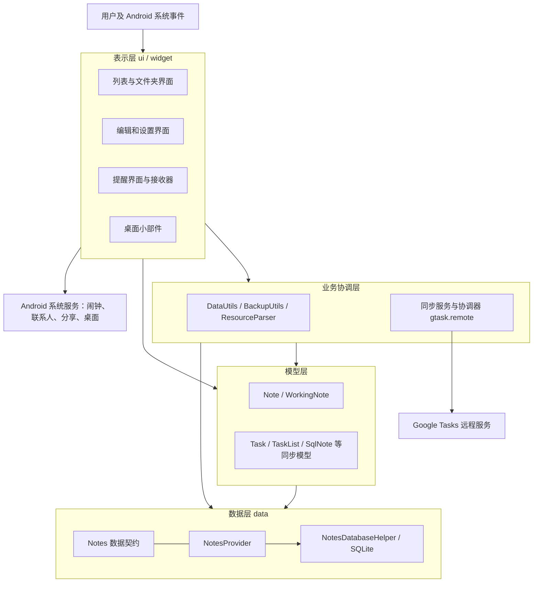
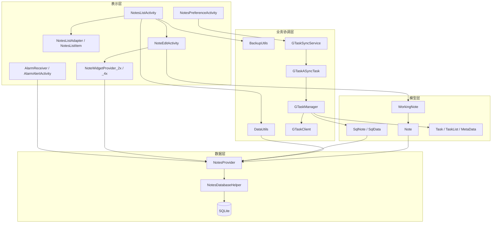

# 小米便签泛读笔记

项目组长：________　成员：________

每人完成的工作：________（请按实际分工填写）

## 一、小米便签的基本功能

本笔记基于当前目录中的 `Notes` 源码、`README`、菜单资源、`AndroidManifest.xml` 和已有的《小米便签功能体验记录》整理。README 将项目描述为 MIUI 团队发起的小米便签开源版，项目地址可参考 [MiCode/Notes](https://github.com/MiCode/Notes)。本次分析以本地代码为准。

功能及体验情况：

1. 新建、编辑、自动保存、查看和删除便签；列表显示内容摘要及时间。已有体验记录中完成了新建、返回保存、重新打开和删除测试。
2. 清单模式：将文字按条目编辑并勾选，保留勾选状态；已有记录验证了进入清单、勾选和重新打开，退出转换未验证。
3. 文件夹：新建、重命名、删除文件夹，以及移动和批量整理便签。已有记录只发现入口，未完成这些操作。
4. 批量选择、删除和移动：列表支持选择模式；记录仅观察了选择界面，未执行批量删除。
5. 搜索便签：支持搜索入口和结果处理；已有记录中搜索后的筛选效果没有得到确认。
6. 便签外观：选择背景颜色、调整字体大小；设置中新建便签背景可随机。记录仅查看了选项，未验证设置持久性。
7. 设置、取消提醒，按时间触发提示；代码还提供开机后恢复提醒的处理。记录仅发现入口，未验证定时触发。
8. 分享便签文本、发送到桌面，提供 2×2 和 4×4 桌面小部件。记录验证了系统分享选择界面，未实际发送或添加小部件。
9. 导出文本到外部存储；记录只发现入口，未执行导出。
10. 选择 Google 账号并与 Google Tasks 同步；记录未添加账号或执行同步，当前服务兼容性未验证。
11. 联系人及通话便签相关处理：识别文本中的电话号码、通过联系人信息显示号码相关名称，并处理通话记录文件夹。具体设备效果未验证。

**源码规模和组织：** 统计范围为 `Notes/src` 下的 `.java` 文件，包含空行和注释，不包括资源、构建产物及依赖，共 **39 个 Java 文件、10,006 行**；这一数字不是有效代码行数。包结构如下：

| 程序包（均以 `net.micode.notes` 为前缀） | Java 文件数 | 职责 |
|---|---:|---|
| `.ui` | 14 | 列表、编辑、设置、提醒及界面控件 |
| `.model` | 2 | 便签及编辑中的工作状态 |
| `.data` | 4 | 数据定义、数据库、内容提供者、联系人 |
| `.tool` | 4 | 数据操作、导出、资源和同步字符串工具 |
| `.widget` | 3 | 桌面小部件 |
| `.gtask.data` | 6 | 同步节点、任务及本地数据映射 |
| `.gtask.remote` | 4 | 同步服务、异步任务、协调和网络通信 |
| `.gtask.exception` | 2 | 同步相关异常 |

`res` 保存布局、菜单、字符串和图片等资源；`AndroidManifest.xml` 注册活动、服务、接收器和数据提供者；Gradle 配置项目构建。`build` 是构建输出，不计入上述源码统计。

## 二、功能与类之间的对应关系

下表列出实现功能的主要类和代表性方法；Android 框架回调、资源和其他辅助类共同参与，不表示每项功能只由表中方法实现。

| 功能 | 主要类及方法 | 对应关系 |
|---|---|---|
| 列表展示、打开便签 | `NotesListActivity.startAsyncNotesListQuery()`、`openNode()`；`NotesListAdapter.bindView()`；`NotesListItem.bind()` | 查询列表，绑定每一行，点击后进入便签或文件夹 |
| 新建、编辑、保存 | `NotesListActivity.createNewNote()`；`NoteEditActivity.createNewNote()`、`saveNote()`；`WorkingNote.load()`、`saveNote()`；`Note.syncNote()` | 界面建立编辑状态，再将工作数据写入持久层 |
| 删除、批量删除 | `NoteEditActivity.deleteCurrentNote()`；`NotesListActivity.batchDelete()`；`DataUtils.batchDeleteNotes()`；`NotesProvider.delete()` | 界面收集目标，数据工具和 Provider 完成删除处理 |
| 文件夹与移动 | `NotesListActivity.showCreateOrModifyFolderDialog()`、`deleteFolder()`、`openFolder()`；`DataUtils.moveNoteToFoler()`、`batchMoveToFolder()`；`FoldersListAdapter.bindView()` | 文件夹界面、目标选择与数据归属更新；方法名 `moveNoteToFoler` 保留源码拼写 |
| 搜索 | `NotesListActivity.onSearchRequested()`；`NoteEditActivity.getHighlightQueryResult()`；`NotesProvider.query()` | 通过 Android 搜索入口、查询数据并在编辑界面处理匹配结果 |
| 清单模式 | `NoteEditActivity.switchToListMode()`、`onCheckedChanged()`、`getWorkingText()`；`NoteEditText`；`WorkingNote.setCheckListMode()` | 切换条目界面、响应勾选，并将模式与文本写入工作状态 |
| 背景、字体与设置 | `NoteEditActivity.onBackgroundColorChanged()`；`WorkingNote.setBgColorId()`；`ResourceParser.getNoteBgResource()`、`getTexAppearanceResource()`；`NotesPreferenceActivity` | 保存颜色选择、映射界面资源并处理偏好设置 |
| 定时提醒 | `NoteEditActivity.setReminder()`、`OnDateTimeSet()`；`WorkingNote.setAlertDate()`；`DateTimePickerDialog`；`AlarmReceiver.onReceive()`、`AlarmAlertActivity`、`AlarmInitReceiver.onReceive()` | 设置时间、接收闹钟、展示提醒并处理开机恢复 |
| 分享、发送桌面 | `NoteEditActivity.sendTo()`、`sendToDesktop()` | 分别调用系统分享与桌面快捷方式相关流程 |
| 桌面小部件 | `NoteWidgetProvider.update()`；`NoteWidgetProvider_2x.onUpdate()`；`NoteWidgetProvider_4x.onUpdate()`；`NoteEditActivity.updateWidget()` | 按尺寸提供桌面视图，并在内容变化时更新 |
| 文本导出 | `BackupUtils.exportToText()`、`exportFolderToText()`、`exportNoteToText()` | 遍历便签及文件夹并写入文本文件 |
| Google Tasks 同步 | `NotesPreferenceActivity`；`GTaskSyncService.startSync()`；`GTaskASyncTask.doInBackground()`；`GTaskManager.sync()`；`GTaskClient` | 设置账号，启动后台同步，协调本地与远程数据和网络请求 |
| 联系人、通话便签 | `Contact.getContact()`；`WorkingNote.convertToCallNote()`；`DataUtils.getCallNumberByNoteId()`、`getNoteIdByPhoneNumberAndCallDate()` | 查询联系人、标记通话便签并关联号码及记录 |

## 三、各包中主要类及作用

以下覆盖 `src` 中全部 39 个顶层 Java 源文件；内部类和匿名监听器没有单独列出。包名前缀均为 `net.micode.notes`。

| 包 | 类 | 主要功能 |
|---|---|---|
| `.data` | Contact | 联系人信息查询及缓存，辅助号码显示。 |
| `.data` | Notes | 定义内容 URI、表字段、类型及系统文件夹等数据契约。 |
| `.data` | NotesDatabaseHelper | 继承 `SQLiteOpenHelper`，创建、升级数据库及触发器。 |
| `.data` | NotesProvider | 继承 `ContentProvider`，提供便签数据的查询、插入、更新和删除。 |
| `.model` | Note | 封装便签和关联数据，负责组织数据并同步到本地持久层。 |
| `.model` | WorkingNote | 表示当前编辑便签，维护文本、颜色、提醒等状态及保存逻辑。 |
| `.tool` | BackupUtils | 文本导出、外部存储路径和输出流处理。 |
| `.tool` | DataUtils | 批量删除、移动、文件夹及通话记录等数据辅助操作。 |
| `.tool` | GTaskStringUtils | 同步用字符串和 JSON 内容的处理工具。 |
| `.tool` | ResourceParser | 根据颜色、尺寸等标识选择背景、字体和小部件资源。 |
| `.ui` | NotesListActivity | 便签和文件夹列表的主界面，处理查询、选择、整理及菜单。 |
| `.ui` | NotesListAdapter | 将查询结果绑定到列表，维护多选状态。 |
| `.ui` | NotesListItem | 列表单项视图，显示摘要、背景和附加状态。 |
| `.ui` | NoteItemData | 从列表数据中封装单个便签或文件夹的展示属性。 |
| `.ui` | NoteEditActivity | 便签编辑主界面，协调保存、清单、提醒、分享等操作。 |
| `.ui` | NoteEditText | 编辑文本控件，处理输入、焦点、按键和上下文菜单。 |
| `.ui` | FoldersListAdapter | 将文件夹数据绑定到文件夹选择列表。 |
| `.ui` | DropdownMenu | 封装下拉菜单和菜单项点击监听。 |
| `.ui` | DateTimePicker | 组合日期与时间选择控件，维护选择值和变化监听。 |
| `.ui` | DateTimePickerDialog | 包装日期时间选择器，向调用方返回所选时间。 |
| `.ui` | AlarmReceiver | 接收定时提醒广播并启动提醒流程。 |
| `.ui` | AlarmInitReceiver | 接收开机广播，恢复已有提醒的调度。 |
| `.ui` | AlarmAlertActivity | 显示提醒界面并处理提示音及用户响应。 |
| `.ui` | NotesPreferenceActivity | 管理偏好设置、同步账号选择、同步状态与操作。 |
| `.widget` | NoteWidgetProvider | 小部件公共更新、删除与资源选择逻辑。 |
| `.widget` | NoteWidgetProvider_2x | 2×2 小部件的更新与尺寸资源。 |
| `.widget` | NoteWidgetProvider_4x | 4×4 小部件的更新与尺寸资源。 |
| `.gtask.data` | Node | 远程同步节点的抽象基类，定义标识、状态及同步接口。 |
| `.gtask.data` | Task | 表示远程任务，处理内容、状态及同步动作。 |
| `.gtask.data` | TaskList | 表示远程任务列表，维护子任务和同步信息。 |
| `.gtask.data` | MetaData | 保存与远程节点关联的附加同步元数据。 |
| `.gtask.data` | SqlNote | 将本地便签及其关联内容映射为同步使用的数据结构。 |
| `.gtask.data` | SqlData | 封装本地便签数据行的读取与提交。 |
| `.gtask.remote` | GTaskSyncService | 后台同步服务，维护同步状态并发出状态广播。 |
| `.gtask.remote` | GTaskASyncTask | 在异步任务中执行同步并更新进度、通知。 |
| `.gtask.remote` | GTaskManager | 协调文件夹、便签、远程节点和冲突相关的同步过程。 |
| `.gtask.remote` | GTaskClient | 处理账号登录、HTTP 请求和远程任务操作。 |
| `.gtask.exception` | ActionFailureException | 表示同步动作执行失败。 |
| `.gtask.exception` | NetworkFailureException | 表示网络通信失败。 |

## 四、体系结构图及类间调用关系图

以下使用 Markdown 的 Mermaid 图表达附件要求的分层结构与主要调用关系；箭头表示主要依赖、调用或数据流，并非列出所有方法调用。图中的层次是为理解源码归纳的逻辑分层，并非项目中严格隔离的物理模块。支持 Mermaid 的 Markdown 阅读器可直接显示图形。

### 4.1 体系结构图

### 4.2 类间主要调用关系图

说明：应用通过 Android `ContentResolver` 访问 `NotesProvider`；图中连接表达数据访问关系，省略框架中介。提醒、同步和小部件还会通过系统事件或广播触发，因此不全是普通的直接方法调用。

## 五、收获

1. 泛读应先从入口、目录和功能出发，再追踪核心数据流，避免一开始陷入每个实现细节。
2. 理解了 Android 应用由 Activity、Service、BroadcastReceiver、ContentProvider 等组件协作：界面处理交互，Provider 统一暴露数据访问，数据库负责持久化。
3. 通过“新建—编辑—保存—列表显示”梳理了界面、工作模型和数据层之间的关系；文件夹、提醒和同步又复用同一份便签数据。
4. 认识到功能入口存在不等于当前环境下完整可用。搜索、提醒、同步和桌面功能还需要在相应设备、账号和权限条件下验证。

## 六、存在的问题

1. 搜索提交后没有观察到筛选结果，原因尚不清楚；需要结合系统搜索配置、不同关键词和日志继续排查。
2. 本地修改和远程任务同时变化时，`GTaskManager` 如何确定同步方向及处理冲突，需要结合具体分支和测试数据进一步精读。
3. 数据库触发器如何维护摘要、版本和文件夹统计，删除与同步标记之间如何配合，需要继续追踪数据库定义与调用。
4. 旧版 Google Tasks 接口、旧式桌面快捷方式和存储权限在当前 Android 与服务环境中的可用性尚未验证。
5. 重启后提醒恢复、清单退出转换、批量移动与导出等尚缺少完整的操作验证。

## 参考材料与范围说明

- 本地附件：`软件工程项目实验/附件1：小米便签泛读笔记模板.docx`。
- 项目说明与代码：`Notes/README`、`Notes/AndroidManifest.xml`、`Notes/src`、`Notes/res`。
- 操作证据：`Notes/doc/小米便签功能体验记录.txt`，记录日期为 2026 年 11 月 6 日。本报告引用已有记录，并未声称本次重新完成安装或全功能实测。
- 已有构建产物：`Notes/build/outputs/apk/debug/Notes-debug.apk`；文件存在不代表本次重新构建或验证安装成功。
