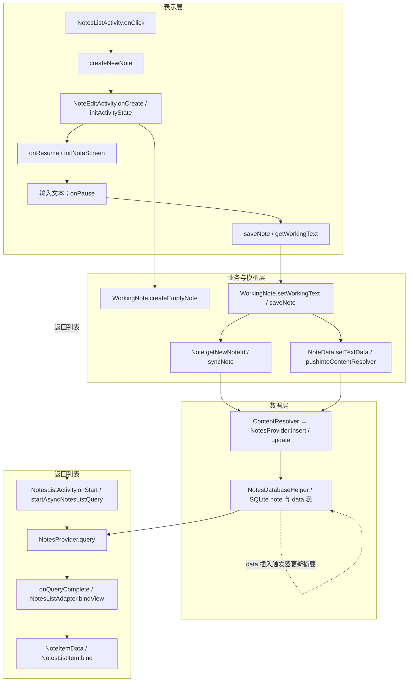

# 小米便签精读笔记

项目组长：________　成员：________

每人完成的工作：________（请按实际分工填写）

## 功能一：新建普通文本便签并保存

### 一、功能介绍

**功能概述：** 在当前文件夹中新建一条普通文本便签，输入内容后离开编辑界面，应用将便签保存到本地数据库，并在列表中显示摘要。

**界面操作步骤：**

1. 打开小米便签，进入便签列表或某个文件夹，点击“写便签 / New note”。
2. 进入编辑页面，在文本区域输入内容；本流程不切换清单、不设置提醒或小部件。
3. 按返回键离开编辑页面，回到列表；列表显示新便签的内容摘要和时间。
4. 再次点击便签，可重新查看刚才输入的内容。

已有 `Notes/doc/小米便签功能体验记录.txt` 记载了新建、输入 `CodexTest123`、返回、重新打开和删除测试便签的操作。本笔记依据该记录及本地代码分析；本次未重新执行设备测试。离开编辑页触发 `onPause()` 保存，进入其他使页面暂停的情形也可能触发保存，并非只有按返回键才保存。新建空便签不保存；仅包含空格是否保存取决于 `TextUtils.isEmpty`，它只判断长度是否为零。

**范围：** 以“普通文本、新建、首次保存、回到列表”为主线。对相关的初始化、持久化和列表绑定方法进行精读；Android SDK 自身方法、资源类、简单字段访问器、其他业务分支及恢复旧便签的全部细节不逐项展开。层次是理解代码的逻辑划分，代码并不完全按严格分层隔离。包名前缀均为 `net.micode.notes`。

### 二、业务流程与方法调用关系

图中 `ContentResolver` 是 Android 框架中介；数据库触发器由 SQLite 执行，不是 Java 方法的直接调用。`NoteData` 是 `Note` 的内部类。列表查询由异步回调完成，图表达先后关系而非同步调用栈。

**数据流：** 列表中的 `mCurrentFolderId` 经 Intent 传入编辑页 → `WorkingNote` 保存当前内容和文件夹 ID → `Note` 组织主记录字段和文本字段 → Provider 分别操作 `note`、`data` 表 → `data` 插入触发器把文本写入主记录 `snippet` → 列表查询主记录并绑定摘要。

### 三、表示层相关类

#### 1. NotesListActivity

**类的作用：** 列表入口，响应新建按钮，传递当前文件夹，并在页面启动时查询列表。

| 主要成员 | 说明 |
|---|---|
| `mCurrentFolderId` | 当前文件夹 ID，新便签作为子项保存到该文件夹。 |
| `mBackgroundQueryHandler` | `AsyncQueryHandler` 子类实例，负责发起异步查询并接收结果。 |
| `mNotesListAdapter` | 把查询到的 Cursor 绑定到列表。 |

| 方法 | 参数及返回值 | 方法作用与执行步骤 |
|---|---|---|
| `onClick(View v)` | `v`：被点击的视图；无返回值 | 判断视图 ID；若是 `btn_new_note`，调用 `createNewNote()`。 |
| `createNewNote()` | 无参数、无返回值 | 创建指向 `NoteEditActivity` 的 Intent；设置 `ACTION_INSERT_OR_EDIT`；附加当前文件夹 ID；调用 `startActivityForResult` 启动编辑页。 |
| `onStart()` | 无参数、无返回值 | 调用父类方法，再调用 `startAsyncNotesListQuery()`。从编辑页返回列表时也会进入此生命周期阶段。 |
| `startAsyncNotesListQuery()` | 无参数、无返回值 | 根据是否为根文件夹选择查询条件；用 `NoteItemData.PROJECTION` 指定列、当前文件夹 ID 指定参数；按类型和修改时间降序发起查询。 |
| `onActivityResult(int requestCode, int resultCode, Intent data)` | 请求码、结果码及返回 Intent；无返回值 | 新建或打开节点返回 `RESULT_OK` 时，将适配器 Cursor 置空；其他结果交给父类处理。 |

**内部类 `BackgroundQueryHandler`：** 其 `onQueryComplete(int token, Object cookie, Cursor cursor)` 中，`token` 区分查询类型，`cookie` 为发起查询时附带的对象，`cursor` 是结果。便签列表查询完成时将 Cursor 交给 `mNotesListAdapter.changeCursor(cursor)`；文件夹查询走另一分支。这里新建流程的查询 cookie 为 `null`。

源码位置：`Notes/src/net/micode/notes/ui/NotesListActivity.java`，约第 206、411、426、465、560 行。

#### 2. NoteEditActivity

**类的作用：** 显示编辑界面，建立工作便签，在页面暂停时收集文本并发起保存。

| 主要成员 | 说明 |
|---|---|
| `mWorkingNote` | 当前编辑状态，包含内容、所属文件夹和底层 `Note`。 |
| `mNoteEditor` | 普通文本编辑控件；清单模式另有条目容器。 |
| `mEditTextList` | 清单条目容器，本主线不启用。 |

| 方法 | 参数及返回值 | 方法作用与执行步骤 |
|---|---|---|
| `onCreate(Bundle savedInstanceState)` | 保存的界面状态；无返回值 | 设置编辑布局；首次创建时调用 `initActivityState(getIntent())`，失败则结束；之后初始化界面资源。已有状态恢复走另外的生命周期分支。 |
| `initActivityState(Intent intent)` | 启动意图；返回是否成功 | 根据 action 区分查看与新建；新建时读取文件夹、小部件、默认背景等参数；普通新建分支调用 `WorkingNote.createEmptyNote`；设置输入法状态和设置变化监听器。 |
| `onResume()` / `initNoteScreen()` | 无参数、无返回值 | 恢复时初始化编辑界面；普通模式设置编辑文本和光标，再根据工作便签状态设置背景、时间及提醒区域。 |
| `onPause()` | 无参数、无返回值 | 调用父类、`saveNote()`，然后清理设置界面状态；此时不代表整个 Activity 已销毁。 |
| `getWorkingText()` | 无参数；返回是否存在已勾选清单项 | 普通模式读取 `mNoteEditor.getText().toString()`，交给 `mWorkingNote.setWorkingText()`；清单模式则按条目和勾选标记拼接。 |
| `saveNote()` | 无参数；返回 `WorkingNote.saveNote()` 的结果 | 先采集界面文本，再调用工作模型保存；返回 true 时设置 `RESULT_OK`，便于列表处理返回结果。该返回值不能单独证明每一步底层写入均成功，见下文。 |

源码位置：`ui/NoteEditActivity.java`，约第 153、182、265、401、785、808 行。

#### 3. NotesListAdapter、NoteItemData、NotesListItem

**类的作用：** 把列表查询结果转成界面可显示的数据和卡片。

| 类及成员 | 说明 |
|---|---|
| `NotesListAdapter` 的 Cursor 和选择状态 | 保存列表数据及多选状态。 |
| `NoteItemData.mSnippet`、`mModifiedDate`、`mId` 等 | 缓存当前 Cursor 行的摘要、时间和标识。 |
| `NotesListItem.mTitle`、`mTime` | 对应卡片中的内容和时间视图。 |

| 方法 | 参数及返回值 | 方法作用与执行步骤 |
|---|---|---|
| `NotesListAdapter.newView(Context context, Cursor cursor, ViewGroup parent)` | 上下文、当前游标、父容器；返回 View | 创建 `NotesListItem`。 |
| `NotesListAdapter.bindView(View view, Context context, Cursor cursor)` | 待绑定视图、上下文、当前游标；无返回值 | 根据当前游标构造 `NoteItemData`，再调用列表项 `bind` 并传入选择状态。 |
| `NoteItemData(Context context, Cursor cursor)` | 上下文和当前游标；构造函数 | 读取 ID、时间、颜色、摘要等字段，移除摘要中的清单标记，并计算列表位置；通话记录另有联系人分支。 |
| `NotesListItem.bind(Context context, NoteItemData data, boolean choiceMode, boolean checked)` | 上下文、行数据、是否选择模式、是否选中；无返回值 | 设置选择框、标题、提醒图标、时间和背景。普通便签使用格式化摘要显示文本。 |

源码位置：`ui/NotesListAdapter.java` 约第 54 行，`ui/NoteItemData.java` 约第 79 行，`ui/NotesListItem.java` 约第 41 行。

### 四、业务与模型层相关类

#### 1. WorkingNote

**类的作用：** 维护编辑期间的工作状态，决定是否值得保存，必要时分配数据库 ID，再把变更交给 `Note`。

| 主要成员 | 说明 |
|---|---|
| `mNoteId` | 便签 ID；新对象初始为 0，正数表示已分配数据库记录。 |
| `mFolderId` | 新便签所属文件夹。 |
| `mContent` | 当前工作文本。 |
| `mNote` | 收集便签及数据字段变化的模型对象。 |
| `mIsDeleted` | 删除状态，影响保存判断。 |

| 方法 | 参数及返回值 | 方法作用与执行步骤 |
|---|---|---|
| `WorkingNote(Context context, long folderId)` | 上下文、文件夹 ID；私有构造函数 | 初始化时间、文件夹、新 `Note`、ID 0、未删除状态和默认模式。 |
| `createEmptyNote(Context context, long folderId, int widgetId, int widgetType, int defaultBgColorId)` | 上下文、文件夹、桌面组件 ID 和类型、默认背景；返回工作便签 | 构造工作对象，再通过 setter 设置背景和小部件属性；此时尚未因构造而插入主记录。 |
| `setBgColorId(int id)`、`setWidgetId(int id)`、`setWidgetType(int type)` | 对应属性值；无返回值 | 值变化时更新工作字段，并用 `Note.setNoteValue()` 收集需要写入的字段；背景变化还可能通知监听器。 |
| `setWorkingText(String text)` | 编辑后的文本；无返回值 | 与原内容比较；变化时更新 `mContent`，调用 `Note.setTextData(DataColumns.CONTENT, mContent)` 收集正文。 |
| `existInDatabase()` | 无参数；返回布尔值 | 以 `mNoteId > 0` 判断当前对象是否已有数据库 ID，不是额外查询数据库。 |
| `isWorthSaving()` | 无参数；返回布尔值 | 已删除、新建且内容为空、已有记录但无本地修改时返回 false；其他情况返回 true。 |
| `saveNote()` | 无参数；返回布尔值；同步方法 | 先判断是否需要保存；新便签调用 `Note.getNewNoteId()` 创建主记录，ID 为 0 则返回 false；随后调用 `mNote.syncNote()`；满足条件时通知更新小部件；最后返回 true。 |

**注意：**此处调用 `syncNote()` 后没有检查其布尔返回值，因此 `WorkingNote.saveNote()` 返回 true 只能表示执行到了该分支，不能保证每个底层步骤都成功。它也不是事务完成证明。

源码位置：`model/WorkingNote.java`，约第 104、177、190、215、219、250、270、284 行。

#### 2. Note 及内部类 NoteData

**类的作用：**`Note` 收集主记录修改；内部 `NoteData` 收集文本等关联数据并通过内容提供者写入。新建主记录和正文记录分开存储。

| 主要成员 | 说明 |
|---|---|
| `mNoteDiffValues` | 待更新的主记录字段及修改标记、时间。 |
| `mNoteData` | `NoteData` 实例，管理文本和通话数据变更。 |
| `NoteData.mTextDataValues` / `mTextDataId` | 待写入的文本字段及对应 data 行 ID；0 表示尚无文本行 ID。 |

| 方法 | 参数及返回值 | 方法作用与执行步骤 |
|---|---|---|
| `getNewNoteId(Context context, long folderId)` | 上下文、父文件夹 ID；返回新便签 ID | 构造创建时间、修改时间、类型、本地修改标记及父文件夹字段；通过 `ContentResolver.insert` 插入 note URI；解析返回 URI 中的 ID。解析异常返回 0，ID 为 -1 抛异常。 |
| `Note()` | 无参数；构造函数 | 初始化主记录差异集合和 `NoteData`。 |
| `setNoteValue(String key, String value)` | 字段名和值；无返回值 | 写入差异集合，同时设置本地修改标记和当前修改时间。 |
| `setTextData(String key, String value)` | 文本数据字段名和值；无返回值 | 委托 `NoteData.setTextData()`。 |
| `isLocalModified()` | 无参数；返回布尔值 | 主记录差异或关联数据差异非空时返回 true。 |
| `syncNote(Context context, long noteId)` | 上下文、便签 ID；返回布尔值 | 检查 ID；无变更直接返回 true；更新 note 主记录后清空主记录差异；如数据有修改则调用 `pushIntoContentResolver`。主记录更新数为 0 只记录错误并继续。 |
| `NoteData.setTextData(String key, String value)` | 字段名和值；无返回值 | 将正文等字段放入文本差异集合，并在主记录差异中设置本地修改标记与修改时间。 |
| `NoteData.isLocalModified()` | 无参数；返回布尔值 | 判断文本或通话数据差异是否非空。 |
| `NoteData.setTextDataId(long id)` | 数据行 ID；无返回值 | 要求 ID 大于 0，保存文本数据 ID，否则抛出异常。 |
| `NoteData.pushIntoContentResolver(Context context, long noteId)` | 上下文、便签 ID；返回 URI 或 null | 检查 ID；为文本字段附加 note ID；新文本行通过 `insert` 写入并从返回 URI 设置 ID，已有行则构造批量更新操作；另有通话数据分支；有待更新操作时调用 `applyBatch`。 |

**值得注意的实现：**首次新建文本时 `insert` 已执行，但若没有待批量更新的操作，`pushIntoContentResolver()` 末尾仍返回 null，导致 `syncNote()` 返回 false；外层 `WorkingNote.saveNote()` 又忽略此结果。因此这些返回值不能简单等同于“正文没有写入”或“整个保存成功”。主记录插入、主记录更新、文本插入不是此路径中一个明确包裹的整体事务，中途失败可能留下部分状态；实际影响需异常注入测试验证。

源码位置：`model/Note.java`，约第 44、68、73、99、103、144、175、181 行。

### 五、数据层相关类

#### 1. Notes、Notes.NoteColumns、Notes.DataColumns、Notes.TextNote

**类的作用：**`Notes` 及其嵌套定义提供 URI、字段名、类型、文本 MIME 类型等契约；各层通过同一套常量表示表与字段。关键成员包括 `CONTENT_NOTE_URI`、`CONTENT_DATA_URI`、`AUTHORITY`、`NoteColumns.PARENT_ID`、`NoteColumns.SNIPPET`、`DataColumns.NOTE_ID`、`DataColumns.CONTENT`。它们主要是常量定义，不是本流程的主动业务方法。

#### 2. NotesProvider

**类的作用：**作为 Android `ContentProvider`，根据 URI 路由对 note/data 表的访问，并通知数据变化。

| 主要成员 | 说明 |
|---|---|
| `mHelper` | 数据库辅助类实例，用于取得可读写的 SQLiteDatabase。 |
| `mMatcher` | 将 URI 匹配到便签集合、单条便签、数据集合等类型。 |

| 方法 | 参数及返回值 | 方法作用与执行步骤 |
|---|---|---|
| `onCreate()` | 无参数；返回布尔值 | 调用 `NotesDatabaseHelper.getInstance(getContext())` 取得辅助对象；返回 true。 |
| `insert(Uri uri, ContentValues values)` | 目标 URI 和字段值；返回带插入 ID 的 URI | 取得可写数据库；按 URI 选择 `note` 或 `data` 表插入；data 路径从字段取得关联 note ID；对相应 URI 发出变化通知；返回附带插入 ID 的 URI。 |
| `update(Uri uri, ContentValues values, String selection, String[] selectionArgs)` | 目标 URI、字段值、选择条件及参数；返回更新行数 | 根据 URI 更新 note 或 data；更新 note 前调用 `increaseNoteVersion`；成功后发送变化通知。单项 URI 从路径解析 ID 并组合条件。 |
| `parseSelection(String selection)` | 附加条件；返回 SQL 片段 | 非空时添加 `AND (...)`，否则返回空字符串。 |
| `increaseNoteVersion(long id, String selection, String[] selectionArgs)` | 目标 ID、条件及参数；无返回值 | 生成并执行版本号加一的 SQL，参与 note 更新。 |
| `query(Uri uri, String[] projection, String selection, String[] selectionArgs, String sortOrder)` | URI、列、条件、条件参数、排序；返回 Cursor | 按 URI 选择对应表或搜索查询；普通列表查 note 表；结果非空时设置通知 URI，供观察者感知变动。 |

源码位置：`data/NotesProvider.java`，约第 83、89、151、231、270、274 行。

#### 3. NotesDatabaseHelper

**类的作用：**管理 SQLite 数据库的创建和升级，建立表、索引、系统文件夹和触发器。首次数据库创建与单次保存属于不同阶段；下面列出与本流程有关的初始化方法及触发器。

| 主要成员 | 说明 |
|---|---|
| `CREATE_NOTE_TABLE_SQL` / `CREATE_DATA_TABLE_SQL` | 创建主记录表和关联数据表的 SQL。 |
| `NOTE_INCREASE_FOLDER_COUNT_ON_INSERT_TRIGGER` | 新建 note 行后更新父文件夹的便签数量。 |
| `DATA_UPDATE_NOTE_CONTENT_ON_INSERT_TRIGGER` | 插入文本 data 行后，将其内容写入对应 note 的 `snippet`。 |

| 方法 | 参数及返回值 | 方法作用与执行步骤 |
|---|---|---|
| `getInstance(Context context)` | 上下文；返回辅助类实例 | 同步获取单例，尚未创建时构造实例。 |
| `onCreate(SQLiteDatabase db)` | 数据库对象；无返回值 | 首次创建数据库时依次创建 note 表和 data 表。 |
| `createNoteTable(SQLiteDatabase db)` | 数据库对象；无返回值 | 执行建表 SQL，重建 note 触发器，创建系统文件夹。 |
| `createDataTable(SQLiteDatabase db)` | 数据库对象；无返回值 | 执行建表 SQL，重建 data 触发器并创建 note ID 索引。 |
| `reCreateNoteTableTriggers(SQLiteDatabase db)` / `reCreateDataTableTriggers(SQLiteDatabase db)` | 数据库对象；无返回值 | 删除旧触发器并重新注册相关触发器；不是每次新建便签都执行。 |

插入普通文本的 data 行时，SQLite 按 MIME 类型条件执行摘要触发器；列表随后查询的是 note 表的 `snippet`。数据表和主表通过 `DataColumns.NOTE_ID` 关联。源码位置：`data/NotesDatabaseHelper.java`，约第 113、138、213、273、280、290、298 行。

### 六、完整执行过程与关键判断

1. 用户点击新建按钮，列表页用 Intent 将当前文件夹 ID 交给编辑页；并没有在这一步立即创建数据库行。
2. 编辑页根据 action 创建空 `WorkingNote`。初始化颜色、小部件等字段可能积累待更新值，但新建空文本仍会被 `isWorthSaving()` 排除。
3. 用户输入文字，页面暂停时 `getWorkingText()` 把编辑控件内容交给 `WorkingNote.setWorkingText()`，再由 `NoteData` 收集正文和修改标记。
4. `WorkingNote.saveNote()` 判断内容非空后调用 `getNewNoteId()` 插入 note 主记录，取得 ID；接着 `syncNote()` 更新主记录并写入 data 文本行。
5. Provider 使用 SQLite 执行插入与更新。文本行插入触发摘要更新，note 行插入触发父文件夹数量更新。
6. 返回列表后重新发起异步查询；查询结果通过 Cursor、适配器和列表项显示。实际 UI 刷新也受生命周期及内容变更通知共同影响。
7. 再次打开时应用按 ID 读取已有记录和数据。本笔记将其作为结果验证，不展开整个旧便签加载分支。

## 3. 收获

1. 沿用户操作追踪代码，比单独阅读类更容易看清 Intent、生命周期、模型、Provider 和 SQLite 之间的关系。
2. 新便签先在内存中形成工作状态，真正需要保存时才创建主记录；正文和便签元数据分开存储，通过 ID 建立关联。
3. 列表摘要不是在列表界面直接生成，而是由数据库触发器在文本数据变动时更新到主记录。
4. 对返回值需要结合上下文判断：此项目保存链中的不同布尔值和 URI 存在容易误解的情况，不能只看方法名称推断持久化成功。

## 4. 存在的问题

1. `pushIntoContentResolver()` 首次插入后可能返回 null，而调用者忽略 `syncNote()` 返回值；在插入失败、返回 URI 异常或进程中断时，数据和界面状态分别会怎样？需要设计故障注入测试。
2. 主记录和正文分多次写入，若中间发生异常，后续如何发现和修复不完整记录？是否应通过事务或批量操作统一处理？
3. `onPause()` 中同步写入数据库，对大文本或慢速设备的界面响应会有什么影响？需要性能测量。
4. 屏幕旋转、进程被系统回收等情况下，恢复路径如何与保存逻辑协作？需要继续精读状态恢复及设备测试。
5. 查询结果通知和 Activity 返回生命周期在不同 Android 版本下如何共同影响列表刷新？需要在目标设备上进一步验证。

## 参考资料

- 附件模板：`软件工程项目实验/附件2：小米便签精读笔记模板.docx`。
- 源码：`Notes/src/net/micode/notes/ui`、`model`、`data`，以及 `Notes/AndroidManifest.xml`。
- 体验记录：`Notes/doc/小米便签功能体验记录.txt`。本报告采用已有记录，不将尚未操作的异常分支视为验证结果。
